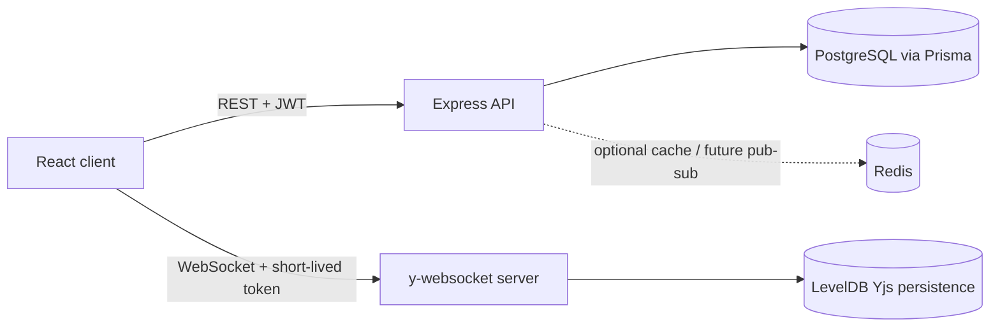

# Architecture

## Responsibilities
- React: workspace UI, TipTap editor, presence/cursor rendering, comments and history panels.
- Express: identity, workspace/page metadata, membership authorization, comments and snapshots.
- PostgreSQL: users, workspaces, memberships, pages, comments and snapshots.
- Yjs: CRDT document model; concurrent text operations merge without a central lock.
- y-websocket: distributes Yjs updates and awareness/presence to connected clients.
- LevelDB: local durable persistence for collaboration documents.
- Redis: reserved extension point for shared pub/sub and operational coordination when scaling.

## Collaboration flow
1. User signs in and receives a JWT.
2. Client asks API for a 15-minute collaboration token.
3. Client opens a Yjs WebSocket room named after the page ID.
4. Yjs exchanges document updates and awareness state.
5. `y-websocket` persists document updates through the configured LevelDB store.

## Scaling boundary
This package is deliberately single collaboration-node by default. Horizontal scaling requires shared durable Yjs storage and cross-node update/awareness fanout (for example a tested Redis pub/sub provider). Merely setting `REDIS_URL` does not enable that behavior.
